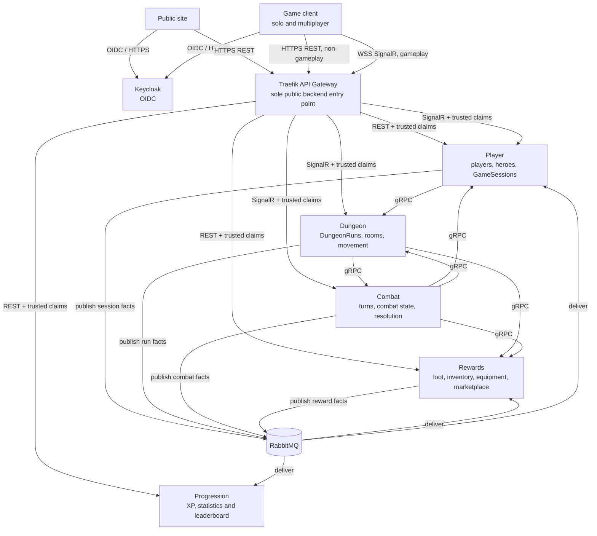
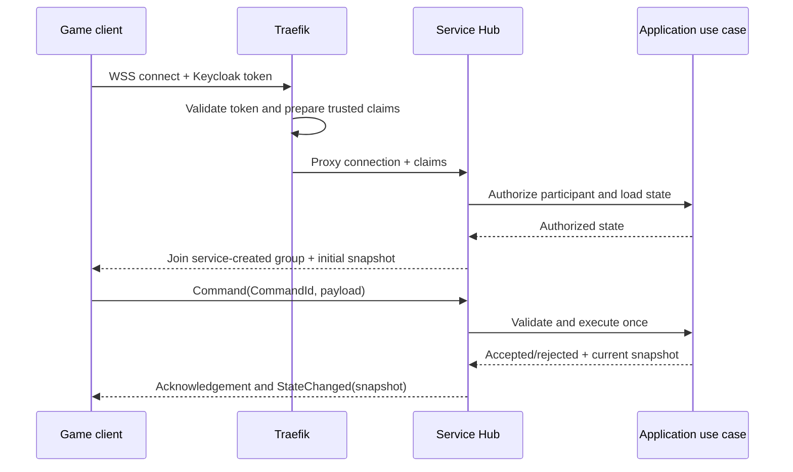
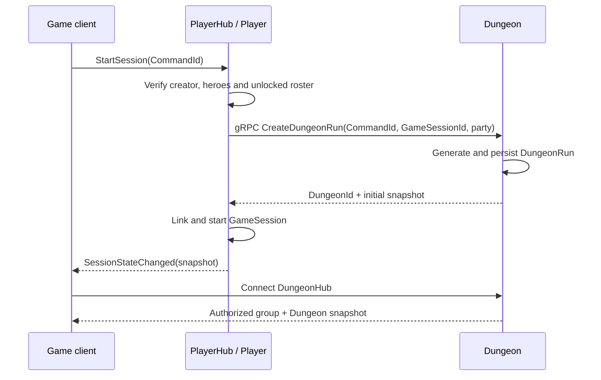
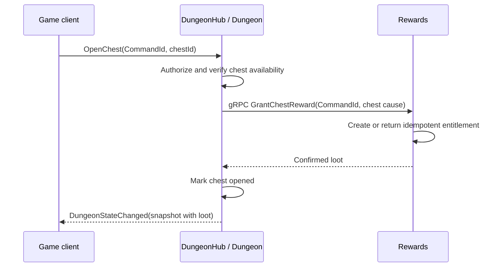
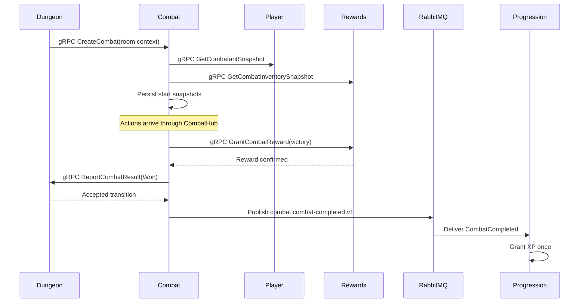

# Microservice communication architecture

> Detailed MVP reference for communications between the frontend, Traefik,
> Keycloak, Player, Dungeon, Combat, Rewards, Progression and RabbitMQ.

## 1. Macro view

The system contains exactly five business microservices: **Player**, **Dungeon**,
**Combat**, **Rewards**, and **Progression**. They are private Kubernetes
workloads. **Traefik** is their only public entry point and **Keycloak** is the
technical identity provider, not a business microservice.

| Need | Transport | Boundary |
|---|---|---|
| Non-gameplay frontend operation | HTTPS/REST, JSON | Frontend to Traefik to owning service |
| Gameplay, in solo and multiplayer | SignalR over WebSocket | Game client to Traefik to owning Hub |
| Immediate internal answer | gRPC, Protobuf | Service to service, internal network |
| Deferred business fact | RabbitMQ, versioned Protobuf | Producer to independent consumer |



### Gateway and identity rules

- Traefik validates the Keycloak token, strips or overwrites client-supplied
  internal identity headers, and forwards normalized claims: `UserId`,
  `Username`, roles and `CorrelationId`.
- Traefik proxies WebSocket upgrades and Hub traffic. It does not hold gameplay
  state, consume RabbitMQ messages or become a BFF.
- A service authorizes each resource itself. A valid token never permits joining
  another player's session, dungeon or combat.
- No service accesses another service's database or is exposed directly to the
  internet.

## 2. Ownership and responsibilities

| Owner | Source of truth | Explicitly not owned |
|---|---|---|
| Player | Player business identity, heroes, `GameSession`, creator, roster and selected heroes | Tokens, equipment, dungeon state, XP |
| Dungeon | `DungeonRun`, random generation, around 40 rooms, interiors, positions, rooms and run lifecycle | Heroes, combat resolution, loot, XP |
| Combat | Combat instance, turn order, authoritative combat state, combat result and start snapshots | Durable hero identity, inventory, DungeonRun, XP |
| Rewards | Reward entitlement, loot, items, consumables, inventory, equipped inventory, marketplace/payment order | Combat state, run lifecycle, XP |
| Progression | XP, level/progression, fact history and leaderboard projections | Authentication, session, hero ownership and inventory |

A `GameSession` is not a technical login session and is not a `DungeonRun`.
Player owns the party and selected heroes; Dungeon owns the generated run. A
started session references one run. Only its creator starts or abandons the run;
the roster is locked once it starts. See ADR-GLOB-011.

## 3. Frontend communication

### 3.1 HTTPS/REST for non-gameplay

| Gateway route family | Owner | Operations |
|---|---|---|
| `/api/player/...` | Player | Read profile, create/select/read heroes |
| `/api/rewards/...` | Rewards | Read inventory, equip/unequip outside combat, marketplace/purchase |
| `/api/leaderboard/v1/...` | Leaderboard | Read statistics and leaderboard |
| OIDC endpoints | Keycloak | Sign-in, token acquisition and renewal |

REST payloads are JSON. Controllers are thin application boundaries and must not
create an HTTP duplicate of a gameplay Hub command.

### 3.2 SignalR/WebSocket for all gameplay

The game client uses identical gameplay commands for solo and multiplayer. A Hub
checks participant membership, joins a service-created group, then sends a full
initial snapshot. Clients never select a group name.

| Hub | Traefik route | Owner | Group | Commands | Published snapshot event |
|---|---|---|---|---|---|
| `PlayerHub` | `/hubs/player` | Player | `session:{SessionId}` | Create, join, start, abandon session | `SessionStateChanged` |
| `DungeonHub` | `/hubs/dungeons` | Dungeon | `dungeon:{DungeonId}` | Snapshot, move, enter room, open chest | `DungeonStateChanged` |
| `CombatHub` | `/hubs/combats` | Combat | `combat:{CombatId}` | Snapshot, action, pass turn, consume potion | `CombatStateChanged` |

Every command includes a unique `CommandId`. The Hub replies explicitly with an
accepted/rejected acknowledgement; an accepted state change produces a complete
authoritative snapshot. This makes replay and client resynchronization safe.



Dungeon and Combat run one replica each in the MVP. There is no Redis SignalR
backplane yet, but groups are used from the start so a Redis backplane can be
added later without changing the frontend protocol.

## 4. Synchronous gRPC exchanges

gRPC contracts are producer-owned, versioned Protobuf NuGet packages. Calls
carry correlation context, have a deadline, and are retried only with the same
idempotency key when retrying is safe.

| Caller → callee | Operation | When / request essentials | Required result and rule |
|---|---|---|---|
| Player → Dungeon | `CreateDungeonRun` | Creator starts session; `CommandId`, `GameSessionId`, party and selected heroes | `DungeonId` + initial snapshot. Same command returns existing run; no second run. |
| Player → Dungeon | `AbandonDungeonRun` | Creator abandons; `CommandId`, session and dungeon IDs | Confirmation of `Abandoned`. A repeated request returns the same terminal result. |
| Dungeon → Combat | `CreateCombat` | A combat room is entered; command, run, room/encounter and participant context | `CombatId` + initial snapshot. Same room cause must not create two combats. |
| Combat → Player | `GetCombatantSnapshot` | Combat initialization; hero/participant IDs | Immutable relevant hero snapshot. Failure prevents safe initialization. |
| Combat → Rewards | `GetCombatInventorySnapshot` | Combat initialization; hero IDs | Equipped inventory and consumable snapshot. Failure prevents safe initialization. |
| Dungeon → Rewards | `GrantChestReward` | Open chest; command, run/room/chest cause, recipient | Persisted loot. Chest is not marked opened until confirmed. |
| Combat → Rewards | `GrantCombatReward` | Win; command, combat/victory cause, recipients | Persisted loot before victory finalization. Final boss has final-boss reward only. |
| Combat → Dungeon | `ReportCombatResult` | Combat finishes; command, combat, room and `Won`/`Lost` result | Updated room/run state. A win is reported only after reward confirmation. |

Combat persists the Player and Rewards snapshots obtained at creation. Equipment
changed later cannot alter that combat. The frontend blocks equip/unequip during
combat; the MVP adds no backend inventory reservation.

## 5. RabbitMQ asynchronous exchanges

### 5.1 Centralized statistics flows to Progression

**Player, Dungeon, Combat and Rewards publish their statistical facts to
Progression.** Progression centralizes statistics, history, XP and leaderboard
projections. This centralization does not transfer ownership: the producer
remains the source of truth and Progression stores immutable facts and its own
derived projections.

Each producer writes its state change and an outbox message in its local
transaction; a worker publishes the outbox to RabbitMQ. A statistical fact is
therefore not lost if publication fails after the business state changed.
Progression's durable queues are bound to all statistical routing keys,
independently from the Player and Rewards queues.

| Routing key | Producer | Publish point | Progression projection |
|---|---|---|---|
| `player.game-session-started.v1` | Player | Session started and linked to a run | Participation and session counters |
| `player.game-session-ended.v1` | Player | Session closed | Effective participation end |
| `player.hero-created.v1` | Player | Hero created | Hero creation and archetype distribution |
| `player.game-session-member-joined.v1` | Player | Participant added to roster before locking | Party size and composition |
| `dungeon.dungeon-run-started.v1` | Dungeon | Run created | Run and non-sensitive statistical dimensions |
| `dungeon.room-entered.v1` | Dungeon | Room actually entered | Exploration, progress and room counters |
| `dungeon.chest-opened.v1` | Dungeon | Chest marked open after Rewards confirmation | Chest exploration, distinct from granted loot |
| `dungeon.dungeon-run-ended.v1` | Dungeon | Run is `Won`, `Lost` or `Abandoned` | Outcome, duration and final counters |
| `combat.combat-started.v1` | Combat | Start snapshots persisted and combat is playable | Combat count, participants, encounter and difficulty context |
| `combat.action-resolved.v1` | Combat | Every accepted, resolved action: attack, ability, defence, pass or potion | Actions, damage/healing, targets, effects, turns and per-hero performance |
| `combat.combat-completed.v1` | Combat | Combat completed and Dungeon accepted result | Win/loss, combat statistics and applicable XP |
| `rewards.reward-granted.v1` | Rewards | Reward entitlement persisted | Loot and reward value |
| `rewards.inventory-item-consumed.v1` | Rewards | Durable consumption applied | Consumable usage |
| `rewards.equipment-changed.v1` | Rewards | Equip/unequip outside combat confirmed | Equipment statistics |
| `rewards.purchase-completed.v1` | Rewards | Marketplace purchase/payment confirmed | Economic statistic |

`combat.combat-completed.v1` is now produced for both wins and losses, after
Dungeon accepts the result. A win waits for reward confirmation; a loss creates
no reward. Progression determines from the result whether XP applies. Read the
legacy catalogue line below with this updated semantics.

`combat.action-resolved.v1` is emitted **once for every accepted, resolved
action**, after the atomic Combat-state and outbox update. It covers attacks,
abilities, defences, passing a turn and potions. Its payload includes at least
`CombatId`, `TurnNumber`, actor, action type, targets, aggregate results
(damage, healing, effects) and `CommandId`. Rejected commands, snapshot reads
and SignalR redeliveries emit no statistics fact. Rewards still confirms durable
potion consumption through `rewards.inventory-item-consumed.v1`; Progression
must not count it twice.

Statistics events contain only identifiers and measures needed for analysis
(pseudonymized `PlayerId`/`HeroId` where required, session/run/combat IDs,
outcome, counters and timestamps). They carry neither secrets nor tokens, nor
complete inventory or combat snapshots. A correction or enrichment is a new
event: Progression never changes data owned by another service.

RabbitMQ carries business facts that do not require an immediate response. Its
redelivery behavior provides at-least-once processing and requires idempotent
consumers. Every payload is a
versioned Protobuf contract from the producer-owned contract package, wrapped in
metadata containing `messageId`, `correlationId`, `causationId`, `messageType`,
`version`, `occurredAt`, `producer` and typed payload.

Events are published to durable exchanges with versioned routing keys. Each
consumer service owns a durable queue bound to the routing keys it consumes.
Messages are acknowledged only after successful processing; retries and
dead-letter routing handle failures without coupling producers to consumers.

| Routing key | Producer → consumer queue | Publish point | Consumer effect |
|---|---|---|---|
| `combat.consumable-used.v1` | Combat → Rewards | A potion action already updated Combat local snapshot | Consume durable item once. Payload includes `CommandId`, hero ID, item ID and quantity. |
| `combat.combat-completed.v1` | Combat → Progression | Winning combat has confirmed reward and accepted Dungeon result | Grant XP once and update Progression projections. XP is not real-time. |
| `dungeon.dungeon-run-ended.v1` | Dungeon → Player | Run reaches `Won`, `Lost` or `Abandoned` | Close related `GameSession`, then emit `SessionStateChanged`. |

The Gateway never consumes RabbitMQ messages. A consumer changes only its own state and
exposes any client-visible outcome through its own REST API or Hub.

## 6. Critical sequences

### Start a run



### Chest reward



### Winning combat



`CombatCompleted` is published after Dungeon accepts the result, for both wins
and losses, so Progression has complete statistics. A win publishes it only
after reward confirmation; a loss creates no reward. Progression determines
from the result whether an XP grant applies.

### Consumable and end of run

```mermaid
sequenceDiagram
  participant F as Game client
  participant C as CombatHub / Combat
  participant M as RabbitMQ
  participant R as Rewards
  participant D as Dungeon
  participant P as Player
  participant X as Progression
  F->>C: ConsumePotion(CommandId, itemId)
  C->>C: Update local combat snapshot
  C-->>F: CombatStateChanged(snapshot)
  C->>M: Publish combat.action-resolved.v1
  M->>X: Deliver ActionResolved
  C->>M: Publish combat.consumable-used.v1
  M->>R: Deliver; consume item once
  R->>M: Publish rewards.inventory-item-consumed.v1
  M->>X: Deliver InventoryItemConsumed
  D->>M: Publish dungeon.dungeon-run-ended.v1
  M->>P: Deliver DungeonRunEnded
  M->>X: Deliver DungeonRunEnded
  P->>P: Close GameSession
  P-->>P: PlayerHub SessionStateChanged
```

## 7. Reliability and observability

### Asynchronous statistics

Progression deduplicates every received fact by `messageId` and business key
before persisting it in its history and updating projections. Outbox replay and
RabbitMQ redelivery must therefore neither duplicate XP, counters nor rankings.
Progression does not call a producer back to rebuild a statistic; the versioned
event is its read contract.

| Concern | Rule |
|---|---|
| Command replay | Keep `CommandId`; return previous outcome instead of repeating state transition. |
| Event duplicate | Deduplicate by `messageId` or business key; never consume twice, grant XP twice or reopen/close inconsistently. |
| gRPC timeout | Treat outcome as unknown; retry only with same idempotency key. |
| Mandatory reward | Chest and victory reward are synchronous gates; failure leaves operation pending/retryable, not falsely complete. |
| RabbitMQ delay | Eventual consistency is visible only through owner state; the Gateway never waits for a consumer. |
| Tracing | Propagate `CorrelationId` through Gateway, Hub, gRPC and RabbitMQ; use `CausationId` for derived events. |
| Logs | Include `GameSessionId`, `DungeonId`, `CombatId`, hero ID, `CommandId`, reward cause and `messageId` where relevant. |

## 8. Not set up at initialization

- No Redis backplane or multi-replica Dungeon/Combat Hubs initially.
- No joining an active `DungeonRun` and no individual participant abandonment.
